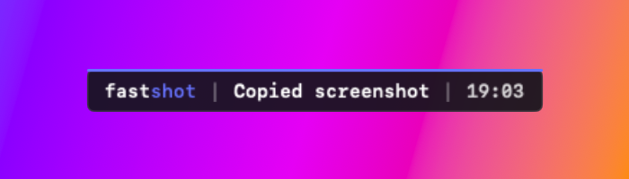
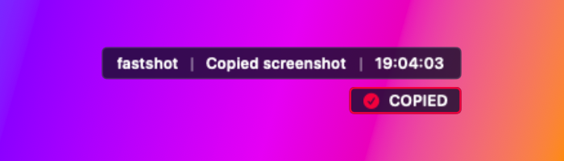
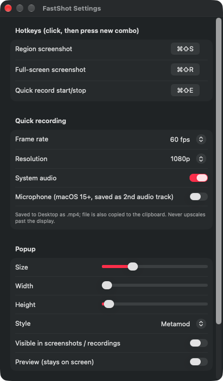

# FastShot

Tiny macOS menu-bar app: region screenshots straight to the clipboard, one-key screen recording to `.mp4`, and a small animated popup that confirms what happened.

## Features

- **Region screenshot** (`⌘⇧S`): the screen dims, only the area you drag stays bright. Crosshair cursor appears instantly, independent of the app underneath.
- **Full-screen screenshot** (`⌘⇧R`)
- **Quick recording** (`⌘⇧E`, press again to stop): full display under the mouse, saved to the Desktop as `.mp4` and copied to the clipboard.
  - FPS: 24 / 30 / 60 / 120
  - Resolution: 720p / 1080p / 1440p / native
  - System audio and optional microphone (macOS 15+)
  - ffmpeg remux (`+faststart`) when ffmpeg is installed
- **Popup** with a center-out text animation, three styles, adjustable size, width and height, optionally visible in screenshots and recordings.
- Remappable hotkeys, launch at login, SwiftUI settings window.

Screenshots go to `~/Desktop/Shot <date>.png` and to the clipboard.

## Popup styles

| Liquid Glass (default) | Metamod | Solus UI v2 |
| --- | --- | --- |
|  |  |  |

Liquid Glass uses the real `glassEffect` on macOS 26+ and a blur material on older versions.

## Settings



## Install

Requirements: macOS 14+, Xcode Command Line Tools (`xcode-select --install`).

```sh
git clone https://github.com/fluidmstr/fastshot.git
cd fastshot
./install.sh
```

This builds `~/Applications/FastShot.app` and launches it. Then:

1. Allow **Screen Recording** when macOS asks (or: System Settings → Privacy & Security → Screen Recording → FastShot). The Settings window shows the current status.
2. Optional, for `.mp4` export with audio mixing: `brew install ffmpeg`. Without it the raw writer output is saved instead.

### Prebuilt release

Download `FastShot.zip` from [Releases](https://github.com/fluidmstr/fastshot/releases), unzip it into `~/Applications`, then run:

```sh
xattr -cr ~/Applications/FastShot.app
```

The build is not notarized, so macOS will otherwise refuse to open it. If hotkeys or capture stop working after a reinstall, remove and re-add FastShot in the Screen Recording list.

### Uninstall

```sh
./install.sh --uninstall
```

## Troubleshooting

- Logs: `~/Library/Logs/FastShot.log`
- Hotkey does nothing: check that no other app has claimed the same combo, or remap it in Settings.
- Recording fails to start: Screen Recording permission is missing.

## License

MIT
